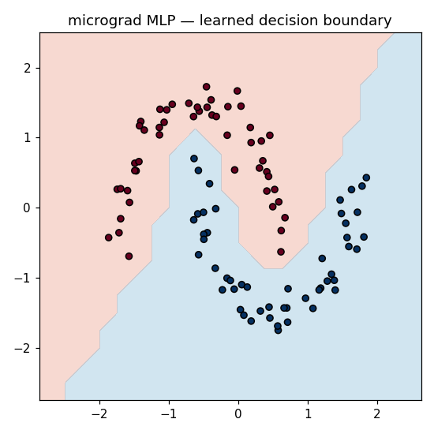

# micrograd-from-scratch

A tiny **reverse-mode automatic differentiation** engine and neural-network library,
built from nothing but Python scalars — then used to train a multilayer perceptron
that learns a non-linear decision boundary.

This is the engine underneath PyTorch/TensorFlow, stripped to its essence: a scalar
`Value` that records how it was computed, and a `.backward()` that walks the graph in
reverse applying the chain rule. ~150 lines, no dependencies for the core.



*The MLP above reaches 100% accuracy on two interleaving moons — trained entirely by
gradients produced by this engine.*

## Quickstart

```bash
git clone <your-repo-url> && cd micrograd-from-scratch
python -m venv .venv && source .venv/bin/activate   # Windows: .venv\Scripts\activate
pip install -r requirements.txt

pytest -q          # run the test suite
python train.py    # train the MLP and save boundary.png
```

## What's inside

| path | what it is |
|------|------------|
| `micrograd/engine.py` | the `Value` autograd core — forward ops + `backward()` |
| `micrograd/nn.py`     | `Neuron`, `Layer`, `MLP` built on `Value` |
| `train.py`            | trains on two-moons, draws the decision boundary |
| `data.py`             | toy two-moons dataset (numpy) |
| `tests/`              | pytest suite: op correctness, finite-difference gradient checks, a learns-the-data test |
| `GUIDE.md`            | **the step-by-step build guide** — start here |
| `SOLUTION/`           | reference implementation (peek only if stuck) |

## How to build it

This repo is a guided project. Open **[GUIDE.md](GUIDE.md)** and work through the
stages; the tests turn green one group at a time as you implement each piece.

## Notes from impl:
We build a graph representing an arbitrary algebraic function of n variables where n is the node count. 
There is one final node - L, the loss function of n-1 variables, which may or may not be independent. Eg. L= f(a,b,c) where a=g(b,c), b=h(c)
The feedforward step is also the graph construction step, so we can't have circular dependencies, the graph is a dag.
Up to stage 2 we have only addition or multiplication operations between nodes allowed. Every node other than a leaf is the result of an operation between 2 nodes (either add or multiply). To represent compositions of more than 2 nodes simply add the result of a+b to c or axb times c etc.
Each node has a value and each node has a grad field that represents the cumulative partial derivative of L wr that node. The way we calculate these gradients follows the idea of backpropagation. 
Each nodes grad field is the partial of L wr its child times the partial of its child wr itself (ie. local partial). 
The local partial is 1 between nodes where the child is a result of the sum of the parent with another. and it is the other parent where child is result of a product. Simply because a = b+c  then da/db = 1 da/dc = 1; a=bxc then da/db = c, da/dc = b.
2 main catches:
1. If a node has 2 or more output nodes, its gradient w/r to L is the cumulative chain-ruled gradients through each of those nodes from L, so grad child1 x local child1/itself + grad child2 x local child2/itself etc. Intuitively, this is because the contribution of that node to L will flow through each of its children.
2. To ensure that dL/dnode is calculated correctly, we have to make sure that the gradients of all of a node's dependencies are calculated before its own.
eg. L=a+b+c, a=b+c. If we try to find dL/db just based on first equation, we will mistakenly assume grad b = grad L x dL/db. but effect of b on L flows both from b and through a as well. 
So we need to build the order of applying chain rule from the leaves up. So we need to traverse the graph depth first. 
Keep in mind traversal and applying the backward step are separate. we need to start the backprop from the final node, but in an order that guarantees all of a node's inputs have been applied before it.
Recursive graph dfs works best since the iterative stack approach requires keeping track of whether all a node's children have been applied before it.


## Credits

The scalar-autograd design follows Andrej Karpathy's
[micrograd](https://github.com/karpathy/micrograd). This version is rebuilt from
scratch as a capstone for the [matrix-calculus](https://github.com/petrycz/Calculus) module of a self-study calculus course,
with a test suite and a guided build.

## License

MIT — see [LICENSE](LICENSE).
